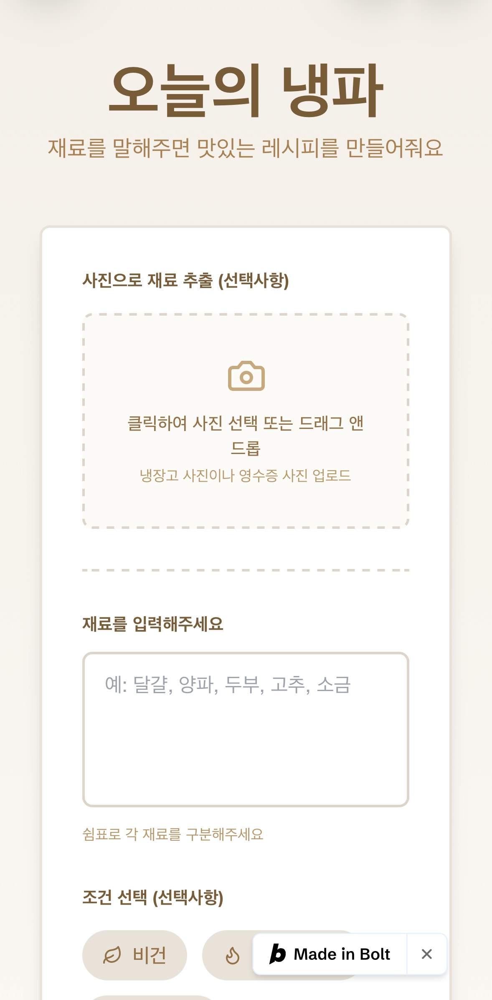
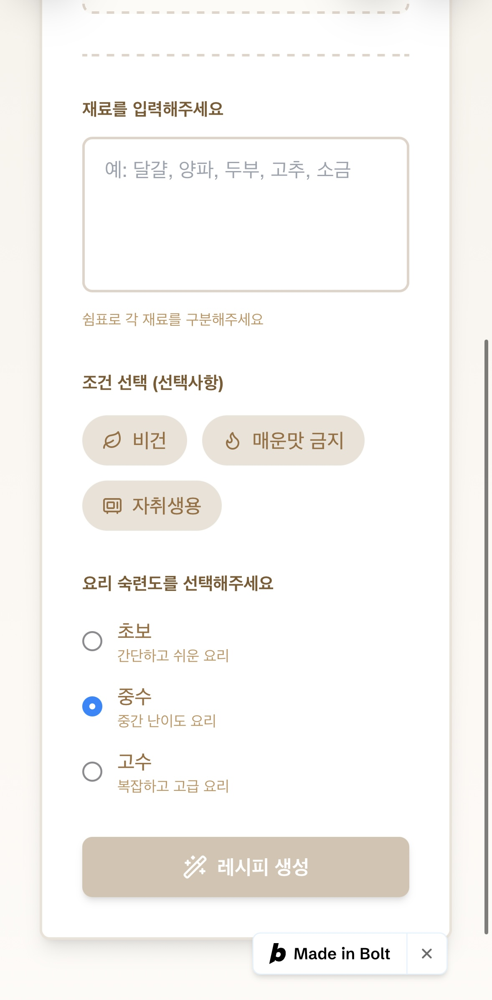

# 오늘의 냉파 (Today's Fridge AI)

냉장고에 남아 있는 식재료와 사용자의 요리 조건을 바탕으로 맞춤형 레시피를 생성하는 AI 요리 도우미 웹앱입니다.

## 개발 배경 및 방식

본 프로젝트는 냉장고에 남아 있는 식재료를 효율적으로 활용할 수 있도록 AI 기반 레시피 추천 서비스를 기획하고 구현한 개인 프로젝트입니다.

Bolt를 활용한 바이브 코딩(Vibe Coding) 방식으로 제작했으며, 생성형 AI를 활용해 서비스 아이디어를 작동하는 웹 애플리케이션으로 구현하는 데 목적을 두었습니다.

## 주요 기능

- **식재료 인식**: 냉장고 사진이나 마트 영수증에서 AI로 식재료를 추출하고 입력창에 자동으로 반영합니다. 직접 입력도 가능합니다.
- **AI 맞춤 레시피 생성**: 보유 식재료, 요리 숙련도(초보/중수/고수), 선택 조건(비건, 매운맛 금지, 자취생용)을 반영한 레시피를 생성합니다.
- **영양 정보 시각화**: AI가 추정한 칼로리와 탄수화물·단백질·지방 함량 및 중량 비율을 차트로 표시합니다.
- **레시피 영수증**: 요리 이름, 소요 시간, 준비물, 조리 과정, 영양 정보를 영수증 형태로 제공하며 이미지 저장 및 인쇄를 지원합니다.

## 실행 화면

### 메인 화면 및 조건 설정

<p align="center">
  
  
</p>

식재료를 직접 입력하거나 사진을 통해 추출하고,
식단 조건 및 요리 숙련도를 설정할 수 있습니다.

### AI 레시피 생성 결과

<p align="center">
  
</p>

AI가 생성한 레시피를 영수증 형태로 제공하며,
준비물, 조리 과정, 영양 정보(추정치)를 확인할 수 있습니다.
생성된 레시피는 이미지로 저장하거나 인쇄할 수 있습니다.

## 기술 스택

- **Frontend**: React 18, TypeScript, Tailwind CSS
- **Build Tool**: Vite
- **AI**: GitHub Models API (GPT-4o, 이미지 인식 및 레시피 생성)
- **Libraries**: html2canvas (이미지 저장), Lucide React (아이콘)
- **Development Tool**: Bolt (바이브 코딩)

## 프로젝트 구조

주요 소스 코드 및 실행 예시 파일을 기준으로 정리했습니다.

```text
src/
├── components/
│   ├── ImageScanner.tsx      # 사진 인식 및 식재료 추출
│   ├── LoadingAnimation.tsx # 로딩 화면
│   ├── RecipeForm.tsx        # 재료 입력 및 조건 설정
│   └── RecipeReceipt.tsx     # 레시피 결과 화면
├── utils/
│   └── openaiClient.ts       # AI API 호출
├── App.tsx                   # 메인 앱
├── index.css                 # 스타일
├── main.tsx                  # 앱 진입점
└── vite-env.d.ts             # Vite 타입 선언

screenshots/
└── recipe-receipt.png        # 레시피 생성 결과 예시
```

## 설치 및 실행

### 환경 요구사항

- Node.js 18 이상 (기존 Vite 5 환경 기준)
- GitHub Models API 사용 권한이 포함된 Personal Access Token

### 패키지 설치

```bash
npm install
```

### 환경 변수 설정

프로젝트 최상위 경로에 `.env` 파일을 생성하고 GitHub Personal Access Token을 입력합니다. `.env.example` 파일을 참고할 수 있습니다.

```ini
VITE_GITHUB_TOKEN=your_github_personal_access_token
```

### 실행

```bash
npm run dev
```

브라우저에서 터미널에 안내된 로컬 주소(기본값 `http://localhost:5173`)로 접속합니다.

### 빌드

```bash
npm run build
```

## 유의사항

- 생성된 레시피와 영양 정보는 AI가 제공하는 참고용 정보이며, 실제 식재료와 조리 방법에 따라 달라질 수 있습니다.
- 개인 로컬 실행용 프로토타입입니다. 현재 API 토큰이 클라이언트에 노출될 수 있으므로 실제 토큰이 포함된 파일이나 빌드 결과물을 공개하지 않아야 합니다. 공개 배포 시에는 서버에서 API 토큰을 관리하는 구조가 필요합니다.
